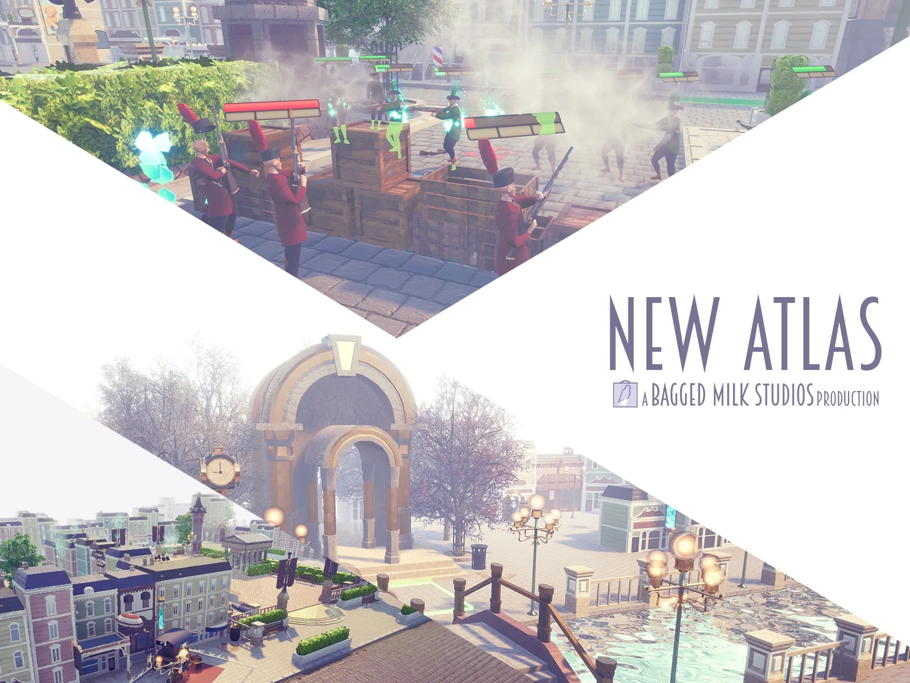
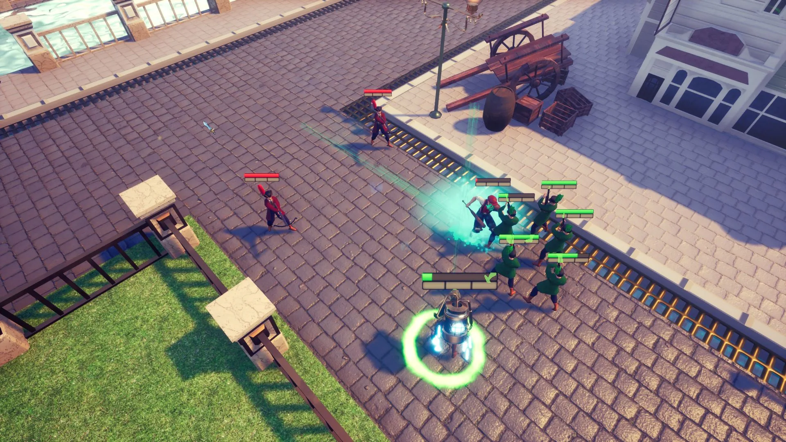
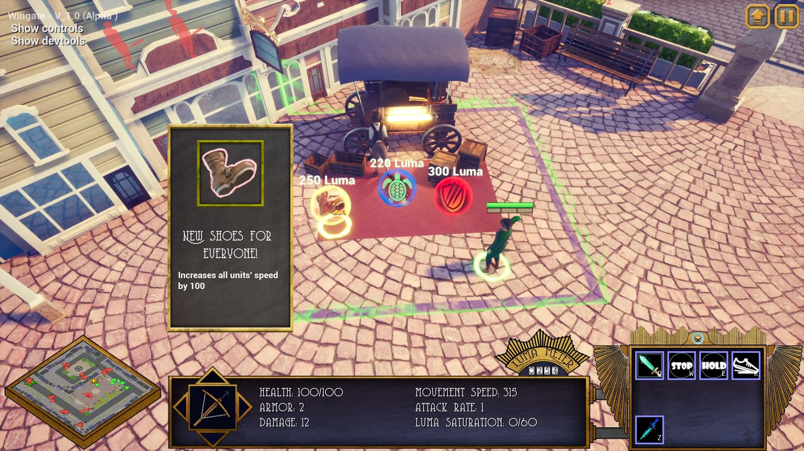
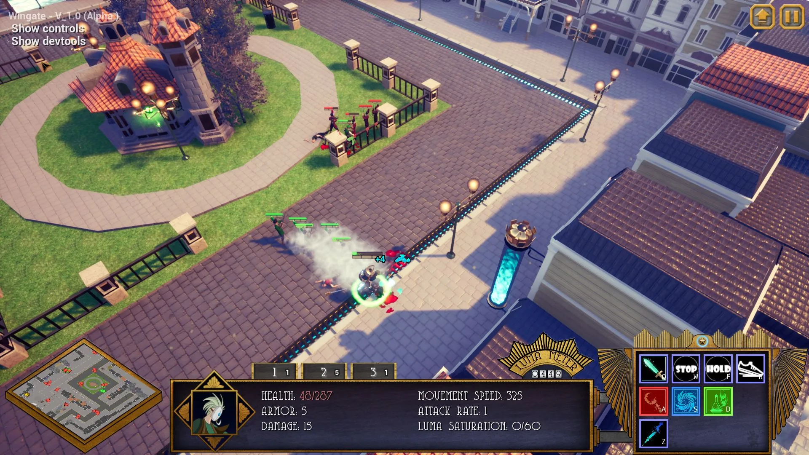
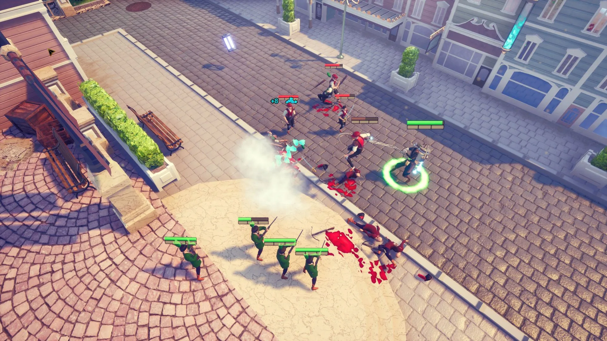
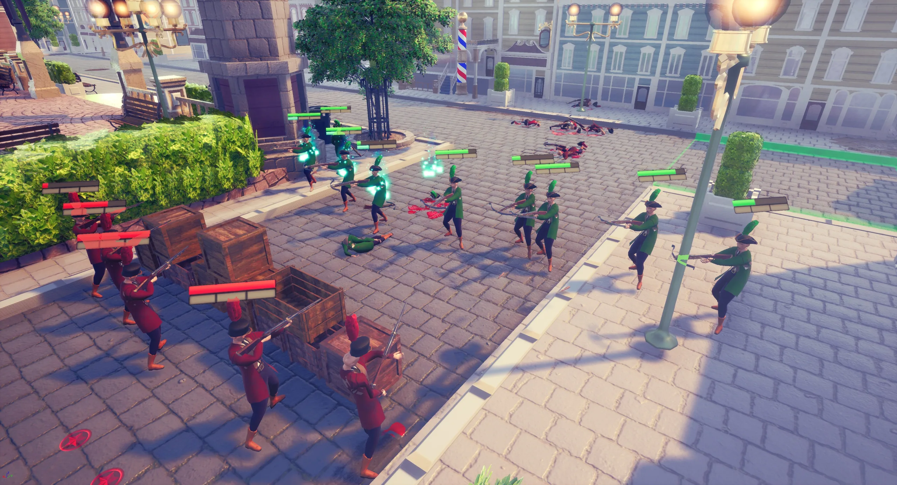
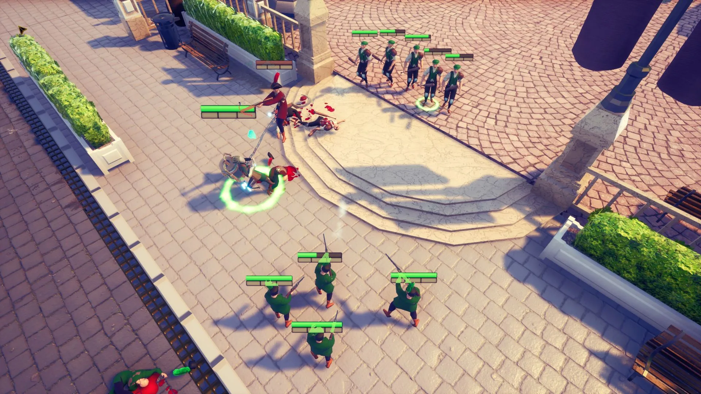
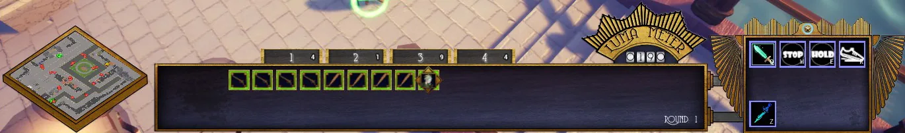
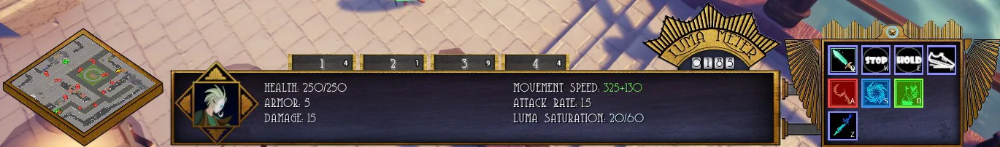

## New Atlas
###### 2018

- Unreal Engine 4, C++

New Atlas is a real-time strategy game I made with **five other team members** over the course of a few months. My responsibilities included the entirety of the **dynamic UI system**, **camera system**, **player selection system**, as well as other smaller systems. This project was a great opportunity for me to learn how to use Unreal Engine 4 and to learn valuable skills for working in a team.

 In New Atlas you control a small army of units through a 1920's era city in search for *luma* - the city's most valuable natural resource. The substance has been used for years as a power source, but recently a variant of it was discovered that, when consumed, gives you super-human speed. Use your specialist units strategically to break down those who stand in your way, while your regular units blast through them in hoards.

<iframe src="https://player.vimeo.com/video/219208002?badge=0&amp;autopause=0&amp;player_id=0&amp;app_id=58479" frameborder="0" allow="autoplay; fullscreen; picture-in-picture; clipboard-write; encrypted-media; web-share" referrerpolicy="strict-origin-when-cross-origin" style="position:absolute;top:0;left:0;width:100%;height:100%;" title="Unreal Engine 4 Particle Scene - Breakdown"></iframe>

Two possible HUD states, dependent on the current selection

**Other team members:**
 - <a class="underline" href="https://yoshavandaele.com/">Yosha Vandaele</a>
 - <a class="underline" href="https://sooi.cherchye.com/">Sooi Cherchye</a>
 - <a class="underline" href="https://brianvanhyfte.com/">Brian Van Hyfte</a>
 - <a class="underline" href="https://michellenaessens.artstation.com/">Michelle Nassens</a>
 - <a class="underline" href="https://aidanv.com/">Aidan Vangrysperre</a>

You can get a better look at the development process by reading the blog posts we made along the way <a class="underline" href="https://baggedmilkstudios.wordpress.com/">here</a>!
