## Redshift
###### 2017

- C#, Unity

Redshift is a fast-paced, high-action, head to head two-player racer set in a stunning low-poly landscape. It was made over the course of **three months** and a **four person team.**

My main roles in the project consisted of **player movement**, **track generation** (using Bézier curves), and **camera movement**. Although, having only two other programmers meant we all needed to work on many systems. Throughout the project I learned many things about working in a team, especially how to better communicate my progress and struggles clearly.

You can see my blog posts made throughout the project here: <a class="underline" href="https://gameprojectsteam20.wordpress.com/author/ajweeks">gameprojectsteam20.wordpress.com</a>

**Team:**

- AJ Weeks *(Programmer)*
- <a class="underline" href="https://www.artstation.com/evgenivdovlov">Evgeni Vdovlov *(Artist)*
- <a class="underline" href="https://emilievangeel.com/">Emilie Van Geel *(Programmer)*
- Pieter Ophalvens *(Programmer)*

  <iframe width="560" height="315" src="https://www.youtube.com/embed/QFYlNuXnN9k" frameborder="0" allowfullscreen></iframe>

<a data-fancybox="gallery" href="/assets/img/redshift-r5ILceh.webp">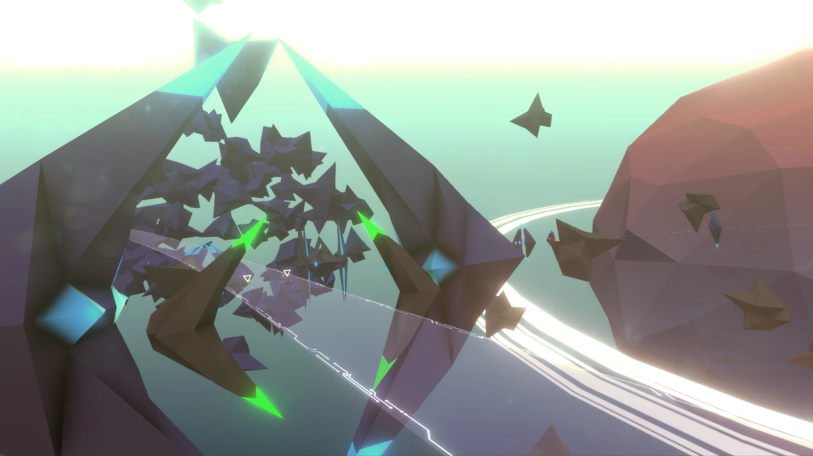</a>
<a data-fancybox="gallery" href="/assets/img/redshift-qbBD6LI.webp">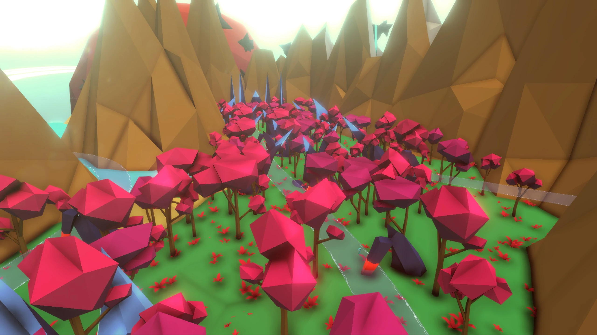</a>
<a data-fancybox="gallery" href="/assets/img/redshift-MsOnes9.webp">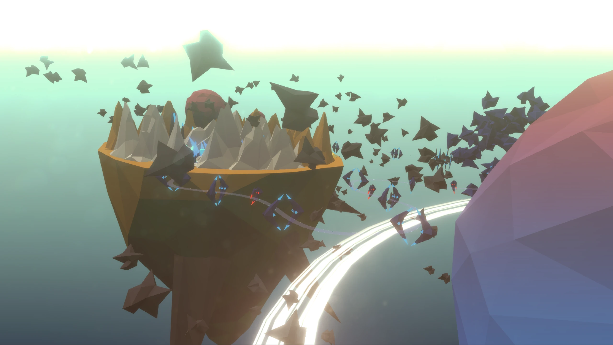</a>
<a data-fancybox="gallery" href="/assets/img/redshift-Nz2hfGz.webp">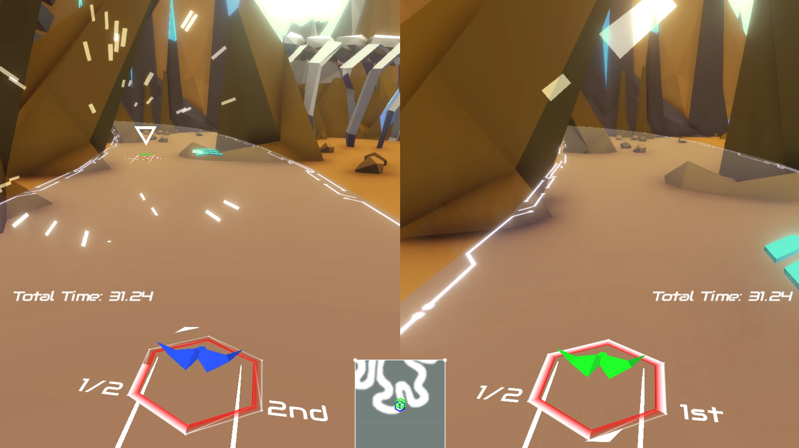</a>
<a data-fancybox="gallery" href="/assets/img/redshift-3mgFvjN.webp">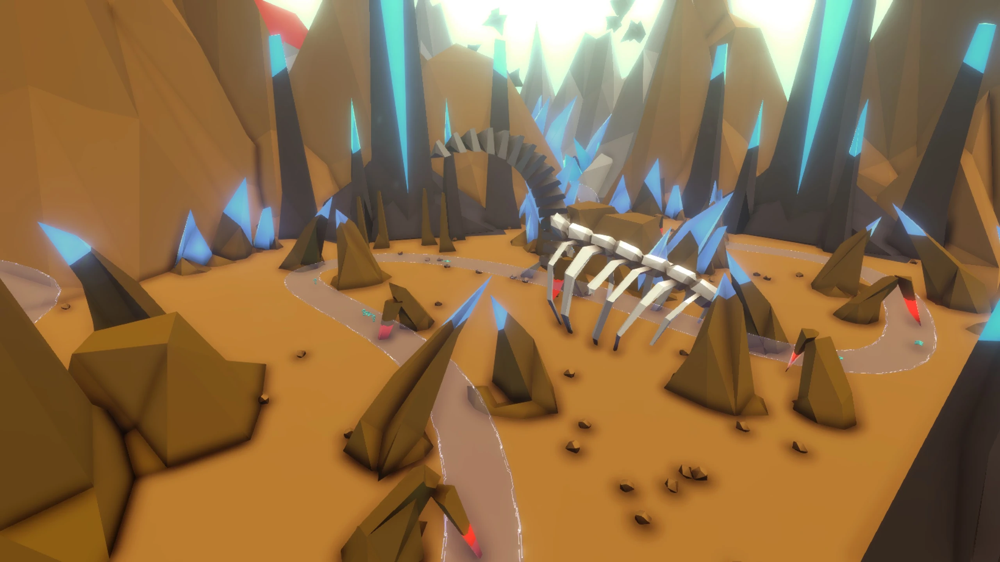</a>
<a data-fancybox="gallery" href="/assets/img/redshift-rjImFwT.webp">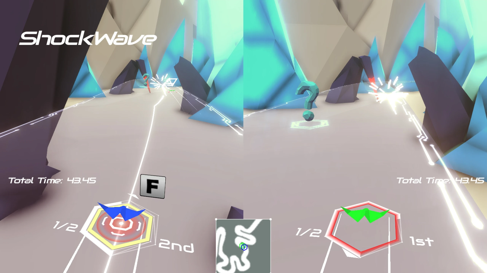</a>
<a data-fancybox="gallery" href="/assets/img/redshift-zjUR1Ps.webp">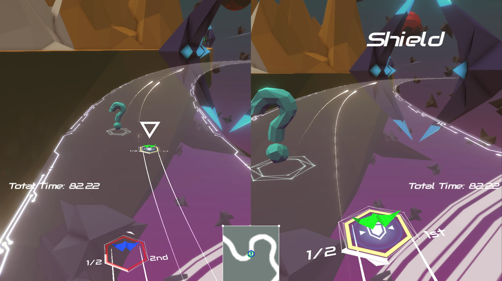</a>
<a data-fancybox="gallery" href="/assets/img/redshift-3dmbJpB.webp">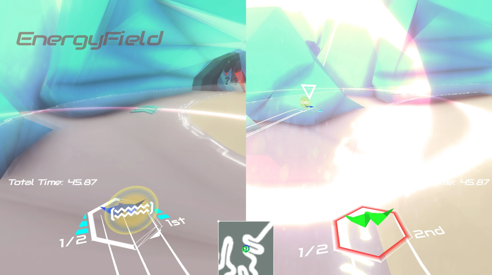</a>

 

### Work-in-progress screenshots

These screenshots were taken while the game was still being developed. One of my main responsibilities on the project was creating and maintaining the track generation tool, which used a series of Bézier curves at its core.

<a data-fancybox="gallery" href="/assets/img/redshift-iU0cFsA.webp">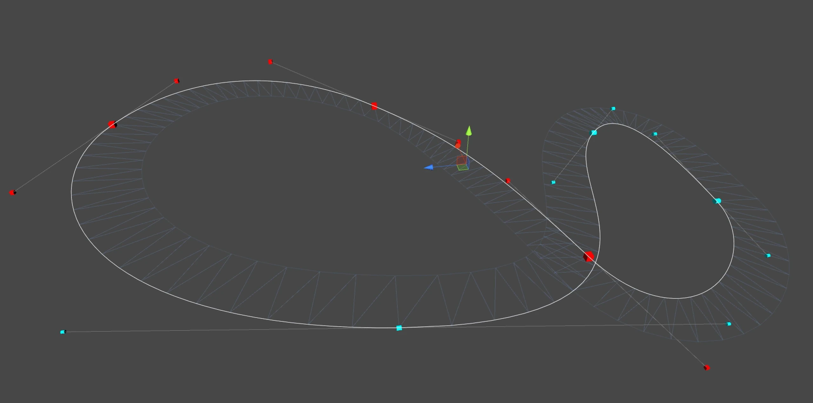</a>
<a data-fancybox="gallery" href="/assets/img/redshift-INIcT1d.webp">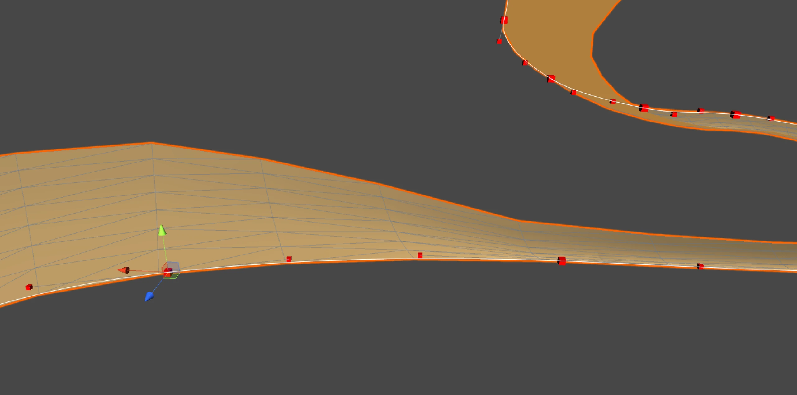</a>
<a data-fancybox="gallery" href="/assets/img/redshift-GQyvF2w.webp">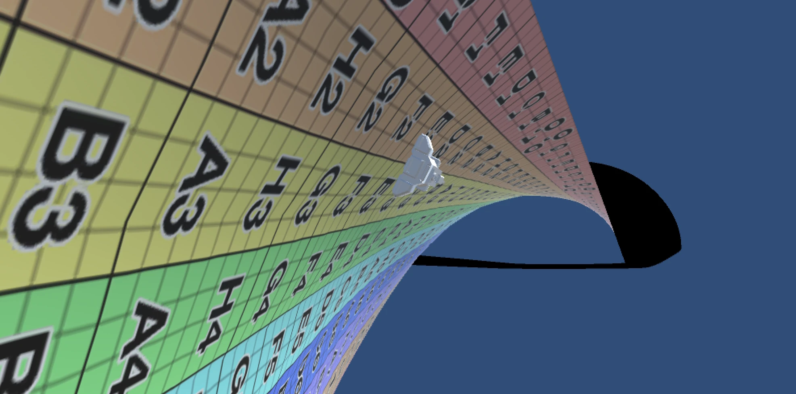</a>
<a data-fancybox="gallery" href="/assets/img/redshift-flMFMj1.webp">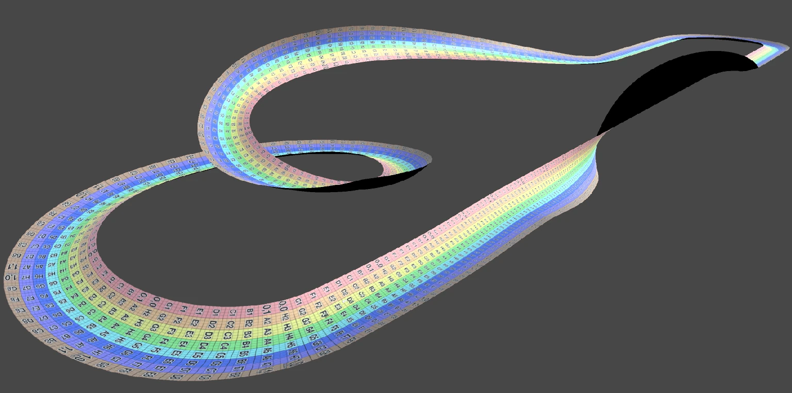</a>
