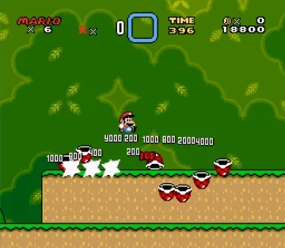
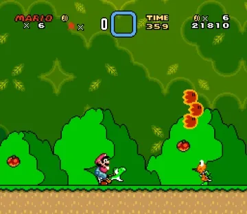
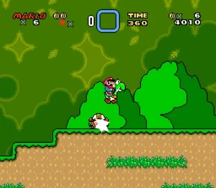
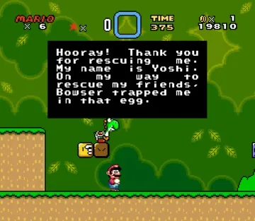
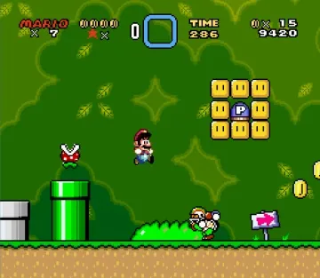
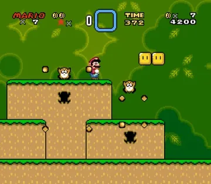
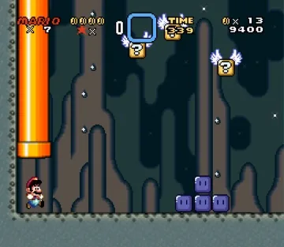
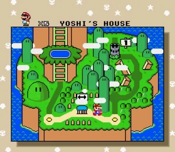
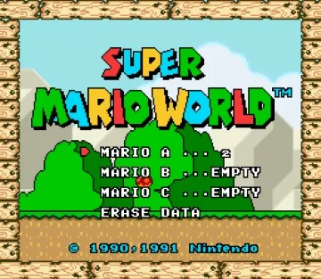
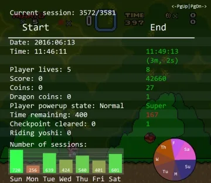

## Super Mario World Remake
###### 2016

As a way to improve my game development skills and put my new knowledge of C++ to the test, I decided to remake one of most well known games of all time. I implemented the entire first level of the first world - sticking as close to the original as possible, and added a main menu, and level selection screen that look identical to the original's.

**Download** the game [here](https://www.dropbox.com/s/uwgc71l5n1k3hdk/SuperMarioWorld_v1.0.zip?dl=0).

Have any feedback? Contact me on twitter [@\_ajweeks\_](https://twitter.com/_ajweeks_)

The entire game was written in C++, and used my school's game engine. You can view the source at [github.com/ajweeks/SuperMarioWorld](https://github.com/ajweeks/SuperMarioWorld).

See it in action:

<iframe width="724" height="400" src="https://www.youtube.com/embed/9ZdGhZt0MlI" frameborder="0" allowfullscreen></iframe>

All designs are property of Nintendo Co., Ltd. and they are in no way associated with this remake.

